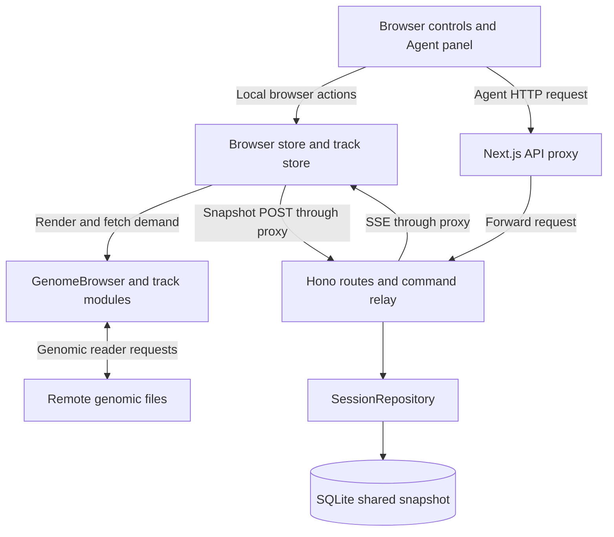
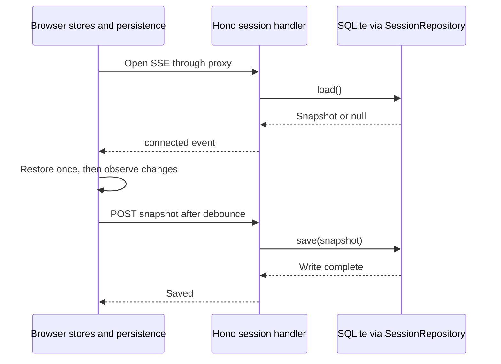

# Architecture and data flow

The browser tab owns live browser state. Next.js serves the website and forwards browser API requests to a separate Hono server. The Hono server relays commands and saves one shared session through an injected database repository.

## Ownership

| Owner                                | Responsibility                                                                   | Lifetime                                           |
| ------------------------------------ | -------------------------------------------------------------------------------- | -------------------------------------------------- |
| `AppProviders`                       | Creates the browser session and command connection above routes                  | Shared layout mount                                |
| `browser/BrowserSession.tsx`         | Browser store and track store                                                    | Survive route changes; restored after refresh      |
| `components/workspace/`              | Navigation, theme, panel widths and collapsed state                              | Panel state survives navigation, resets on refresh |
| `app/api/browser/[...path]/proxy.ts` | Allowed API paths, origin checks, streaming forwarding                           | Each HTTP request                                  |
| Server `http/` and `commands/`       | Local host/origin checks, input validation, explicit routes and command handlers | Each request                                       |
| Server `relay.ts`                    | Connected browsers and SSE streams                                               | Each connection                                    |
| Server `pendingCommands.ts`          | Command IDs, pending replies, timeouts and cancellation                          | Each browser connection, in memory                 |
| Server `storage/`                    | Async session repository and SQLite adapter                                      | One shared durable snapshot                        |

The browser uses `@weng-lab/genomebrowser` for stores and rendering, `@weng-lab/genomebrowser-ui` for browser controls, and `@weng-lab/genomebrowser-tracks` for track implementations. Track fetchers use `@weng-lab/genomic-reader` to read remote genomic files. MUI supplies application controls. The browser and relay share schemas through `@weng-lab/browser-server/protocol`; browser code never imports the Node.js server implementation.



The SSE arrow includes client validation and execution in `browser/connection.ts` and `browser/execute.ts`. It does not let the server mutate the stores directly.

## Apply a command

1. The Agent panel parses a one-based display region, then posts a zero-based, half-open region to `/api/browser/clients/:clientId/region`. An external actor can use the same endpoint through Next.js or call the relay directly.
2. The proxy forwards the local request. The server checks the target connection and validates the region in `commands/setRegion.ts`.
3. The relay locates the browser. Its pending-command tracker registers a reply, assigns `commandId` and `expiresAt`, and sends an SSE `command` event. The HTTP request remains open.
4. The tab validates the event, ignores expired commands, and executes the command against its browser store. The UI and track fetch demand react to that store change.
5. The tab posts its acknowledgement to `/api/browser/clients/:clientId/results`. The tracker resolves the original HTTP request and clears its timer and cancellation listener.

```mermaid
sequenceDiagram
  participant Actor as Agent panel or external actor
  participant Server as Hono server via Next.js proxy
  participant Tab as Browser connection and stores
  Actor->>Server: POST region
  Server->>Tab: SSE command with ID and expiry
  Tab->>Tab: Apply store action
  Tab->>Server: POST result with command ID
  Server-->>Actor: Applied region or rejection
```

The acknowledgement means the store accepted the command. It does not mean track data has loaded or the session has been saved. Autosave is a separate operation. Commands expire after five seconds by default; they are not replayed on reconnect. Timeout, cancellation, disconnect, and failed stream writes clear pending requests. See the [command API](../../README.md#control-a-browser-tab) for local access and response codes.

## Save and restore

On the first connection, the server loads the shared snapshot and includes it in the SSE `connected` event alongside the connection ID. The client validates and restores the stores before showing the browser view. With no saved snapshot, it uses hg38 defaults: the coordinate ruler, GENCODE 50 basic genes in merged display, and human cCREs. A saved track list replaces these defaults.

After initialization, client store changes produce a serializable snapshot. The client debounces writes for 200 ms and sends one save request at a time through the proxy. The server validates it, calls `SessionRepository.save`, and responds after the write completes. `SaveStatus` at the top left of the center panel shows saving, saved, or retry status. Failed writes retry after two seconds.



Reconnection creates a new connection ID but preserves the mounted tab's local session and unsaved edits. A refresh creates new stores and restores the last successful save. All tabs use one saved snapshot; the last save wins, and live edits are not broadcast between tabs. See [Shared session](../../README.md#shared-session) for snapshot contents, retries, and deployment limits.

SQLite is supplied in the server entry point through `SessionRepository`. A remote Postgres implementation can replace it without changing routes, but that adapter is not implemented.

## Load track data

A local browser action or remote command changes the same stores. Core determines which tracks need data; their fetchers use genomic readers to request remote files directly from the browser. The Next.js command proxy, Hono relay, and SQLite database are not on this data path. Fetched records, loading state, and runtime resources are not saved in the session snapshot. Source URLs and track configuration are saved.

For extension points, see [Add a command](../../../server/README.md#add-a-command). Definitions live in the [app glossary](../../glossary.md#commands-and-persistence).

[Back to the docs home](../README.md)
