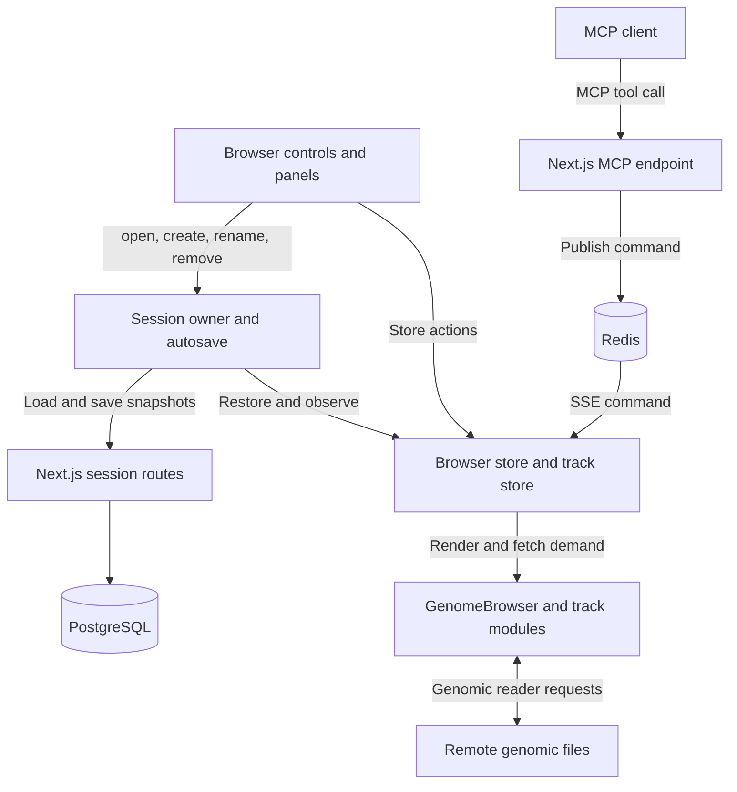
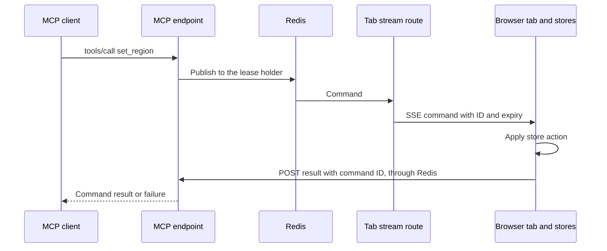
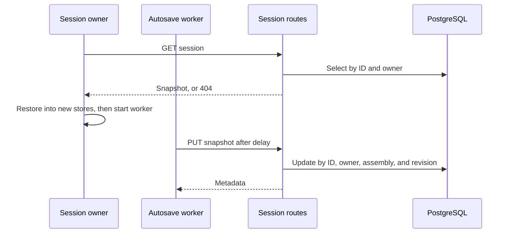

# Architecture and data flow

The browser tab owns live browser state. Next.js serves the website, the saved-session routes, which store each user's sessions in PostgreSQL, and the MCP endpoint. Redis carries agent commands from whichever server instance handles the tool call to the one holding the tab's command stream.

## Ownership

| Owner                                                          | Responsibility                                                       | Lifetime                                              |
| -------------------------------------------------------------- | -------------------------------------------------------------------- | ----------------------------------------------------- |
| `app/(workspace)/layout.tsx`, `AppProviders`                   | Resolve the account; mount session and remote-control providers      | Shared layout mount, per account                      |
| `features/sessions/session.ts`                                 | Session list, open session and its stores, and session operations    | Shared layout mount, per account                      |
| `features/sessions/autosave.ts`                                | Effect worker that saves the open session                            | From restoration until replaced or removed            |
| `features/sessions/transport.ts`                               | Cancellable requests to the session routes                           | Each request                                          |
| `features/assemblies/assemblies.ts`                            | Supported assemblies and their default stores                        | Module                                                |
| `app/api/sessions/`, `features/sessions/server/`               | Identity, validation, ownership checks, PostgreSQL                   | Each request                                          |
| `features/agent/RemoteControlProvider.tsx`, `remoteControl.ts` | Command stream, command execution, and replies                       | While remote control is on and the open session saves |
| `features/agent/commands/`                                     | Each command's definition: tool schema and the function the tab runs | Module                                                |
| `shared/workspace/`                                            | Navigation, theme, panel widths and collapsed state                  | Panel state survives navigation                       |
| `app/api/mcp/`, `features/mcp/server/`                         | MCP tools, caller authentication, and authorization                  | Each MCP request                                      |
| `app/api/sessions/[id]/commands/`, `features/agent/server/`    | Tab streams and replies, authorization, Redis relay                  | Each request; streams up to four minutes              |

The browser uses `@weng-lab/genomebrowser` for stores and rendering, `@weng-lab/genomebrowser-ui` for browser controls, and `@weng-lab/genomebrowser-tracks` for track implementations. Track fetchers use `@weng-lab/genomic-reader` to read remote genomic files. MUI supplies application controls. The session snapshot schema comes from `features/sessions/snapshot.ts`, and tab message schemas from `features/agent/commands/protocol.ts`. Command definitions import only schemas and types, so the MCP endpoint loads them on the server.

The tab looks up each command's definition, validates its parameters, and runs it. The server never mutates the stores directly.

## Apply a command

1. An agent calls an MCP tool, such as `set_region`, with a `sessionId` and the command's parameters. The endpoint verifies the caller's Clerk token and the SDK validates the parameters against the definition's `params` schema.
2. The endpoint checks that the caller owns the session and that the account's Remote Control preference is on. Otherwise the tool fails with `NOT_FOUND` or `REMOTE_CONTROL_DISABLED` and nothing reaches a tab.
3. The relay subscribes for the reply, assigns `commandId` and `expiresAt`, and publishes the command to the connection named by the session's lease in Redis. Without one, the tool fails with `NOT_CONNECTED`.
4. The server holding that connection writes an SSE `command` event. The tab ignores expired commands and rejects commands for a session that is no longer open and saving with `SESSION_CLOSED`. It runs the command and posts its reply to `/api/sessions/:id/commands`, which checks ownership again and publishes the reply.
5. The relay returns the reply. The endpoint checks it against the definition's `result` schema and returns it to the agent.

The reply means the store accepted the command. It does not mean track data has loaded or the session has been saved; the tab's autosave stores the change separately. Five seconds bound the whole dispatch, including every wait on Redis. When the caller cancels or time runs out, the relay sends an SSE `cancel` event and the tab aborts the command's signal; commands are never replayed.

Only one connection receives a session's commands: the one its lease names. The first tab to attach takes the lease. Other tabs get 409 and retry every second until it is free. A tab keeps one tab ID while it reconnects, so its reconnect replaces its own earlier connection, which ends and fails the commands sent to it. Cleanup releases only the connection's own lease, so it cannot release a replacement. Turning off remote control in Settings saves the account's preference and closes the stream. So does the session's `signal` from `features/sessions/session.ts`, which aborts when the session is replaced or closed, or can no longer save edits.

## Save and restore

Opening a session loads `GET /api/sessions/:id`, creates stores for its assembly, and restores the snapshot. Besides the browser and track stores, a session has a store of region groups, which follows the browser's highlights. Only then does autosave subscribe to the stores. A failed or missing load never writes.

Each edit to the stores or the name produces a snapshot. About 200 ms later, the worker sends `PUT /api/sessions/:id` with the whole snapshot and name, the revision it was based on, and a new save ID. It sends one write at a time and keeps the newest edits for the next one. A write acknowledges only the snapshot it sent, and its response gives the revision for the next write. A transient failure may hide a write that was applied, so the same write is retried, under the same save ID, before any newer edits. Refused input is not sent again until a further edit. `CONFLICT` keeps the edits unsaved until the user saves over the other version or discards them. `NOT_FOUND` ends saving rather than recreating the session; its edits stay unsaved and keep the tab from opening another session until they are discarded.

Opening another session saves the open one first and replaces the stores only once nothing is unsaved. Deleting the open session holds writes, waits for one in progress, then deletes. See [Sessions](../../README.md#sessions) for failure behavior and multi-tab limits.

## Load track data

A local browser action or remote command changes the same stores. Core determines which tracks need data; their fetchers use genomic readers to request remote files directly from the browser. The app server is not on this data path. Fetched records, loading state, and runtime resources are not saved in the session snapshot. Source URLs and track configuration are saved.

For extension points, see [Add a command](../../README.md#add-a-command). Definitions live in the [app glossary](../../glossary.md#commands-and-persistence).

[Back to the docs home](../README.md)
