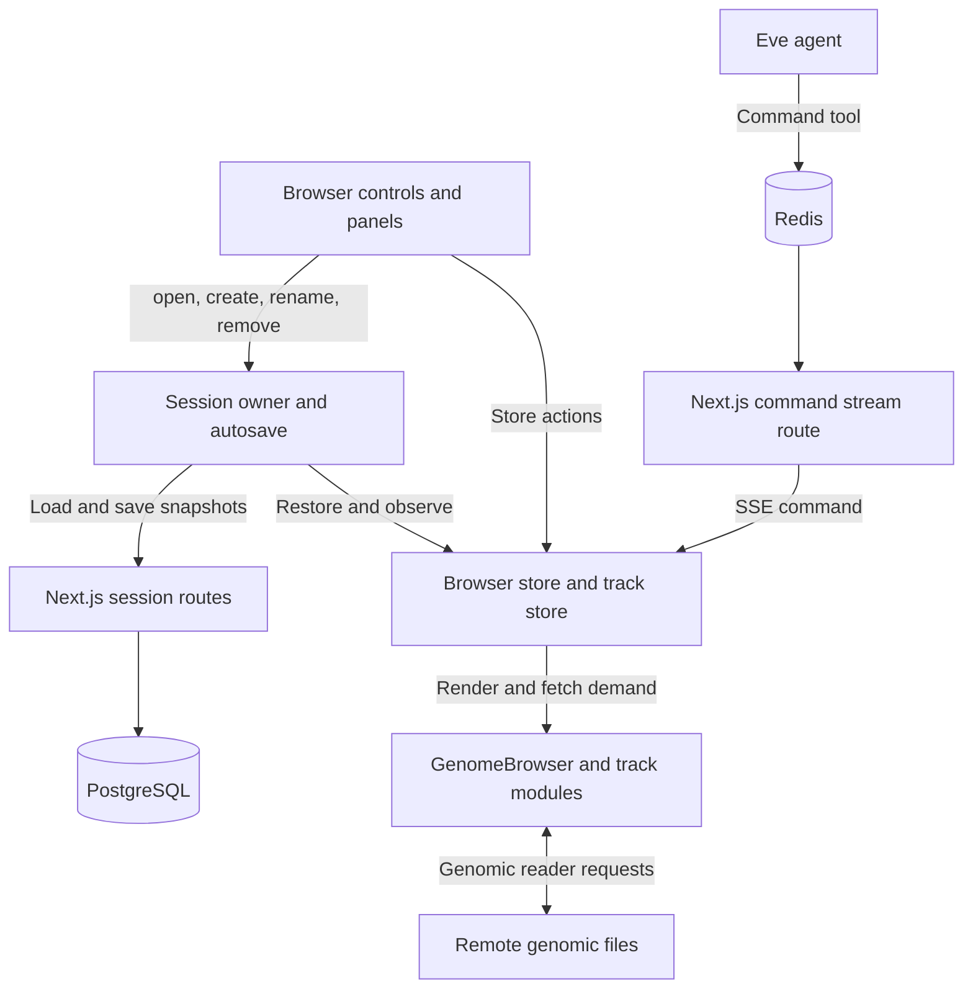
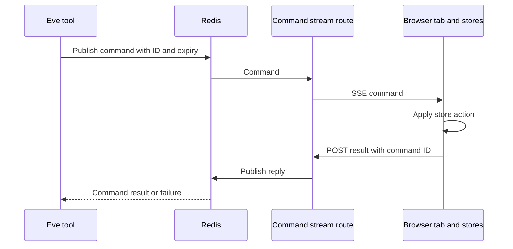
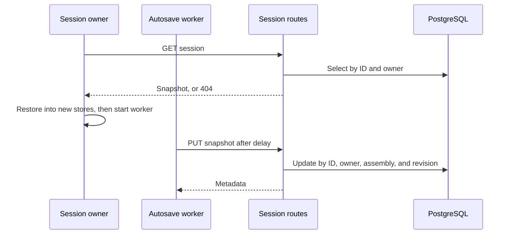

# Architecture and data flow

The browser tab owns live browser state. Next.js serves the website and the saved-session routes, which store each user's sessions in PostgreSQL. It also starts the Eve agent, whose tools deliver commands through Redis to the tab that has the session open.

## Ownership

| Owner                                                  | Responsibility                                                    | Lifetime                                              |
| ------------------------------------------------------ | ----------------------------------------------------------------- | ----------------------------------------------------- |
| `app/(workspace)/layout.tsx`, `AppProviders`           | Resolve the account; mount session and remote-control providers   | Shared layout mount, per account                      |
| `features/account/AccountSettings.tsx`                 | Persisted RC preference, save errors, and refresh across tabs     | Per signed-in account                                 |
| `features/sessions/session.ts`                         | Session list, open session and its stores, and session operations | Shared layout mount, per account                      |
| `features/sessions/autosave.ts`                        | Effect worker that saves the open session                         | From restoration until replaced or removed            |
| `features/sessions/transport.ts`                       | Cancellable requests to the session routes                        | Each request                                          |
| `features/assemblies/assemblies.ts`                    | Supported assemblies and their default stores                     | Module                                                |
| `app/api/sessions/`, `features/sessions/server/`       | Identity, validation, ownership checks, PostgreSQL                | Each request                                          |
| `features/agent/RemoteControl.tsx`, `remoteControl.ts` | The tab's command stream, the app commands act on, and replies    | While remote control is on and the open session saves |
| `features/agent/commands/`                             | Command definitions, agent tools, relay, and stream routes        | Module; relay clients per server process              |
| `agent/`                                               | Eve agent: model, instructions, chat channel, one file per tool   | Eve process                                           |
| `shared/workspace/`                                    | Navigation, theme, panel widths and collapsed state               | Panel state survives navigation                       |
| Redis                                                  | Commands, replies, and which tab holds each session               | Messages only; holders expire without a heartbeat     |

The browser uses `@weng-lab/genomebrowser` for stores and rendering, `@weng-lab/genomebrowser-ui` for browser controls, and `@weng-lab/genomebrowser-tracks` for track implementations. Track fetchers use `@weng-lab/genomic-reader` to read remote genomic files. MUI supplies application controls. The session snapshot schema comes from `features/sessions/snapshot.ts`, and command definitions and tab message schemas from `features/agent/commands`. The agent loads the same command files on the server, so they have no browser-runtime dependencies.

The tab looks up each command, validates its parameters, and runs it. The server never mutates the stores directly.

## Apply a command

1. The model calls a command's tool, such as `set_region`, with the command's parameters. Eve validates them against its `params` schema. The tool reads the session ID from the conversation, not from the model.
2. The tool listens for the reply, then publishes the command, with a `commandId` and `expiresAt`, to the session's Redis channel. When no tab's stream is subscribed, it fails with `NOT_CONNECTED`.
3. The tab's stream route forwards the command as an SSE `command` event.
4. The tab ignores expired commands and rejects commands for a session that is no longer open and saving with `SESSION_CLOSED`. It runs the command and posts its reply to `/api/sessions/:id/commands`: the command's result on success, or the store's failure.
5. The route publishes the reply to the waiting tool, which checks it against the command's `result` schema and returns it to the model.

The reply means the store accepted the command. It does not mean track data has loaded or the session has been saved; the tab's autosave stores the change separately. Commands expire after five seconds and are not replayed on reconnect. Timeout, cancellation, and the tab's disconnect end a pending command. The five seconds include reaching Redis. A command cancelled after delivery also reaches the tab as an SSE `cancel` event, which aborts it if it is still running; a command cancelled before delivery is never sent.

Only the first tab to open a session's stream receives its commands. The route answers later tabs with 409, and they retry every second until the first tab disconnects; the first tab itself may reconnect at once. Opening the stream and replying both require the session's signed-in owner. Turning off remote control in Settings closes the stream. So does the session's `signal` from `features/sessions/session.ts`, which aborts when the session is replaced or closed, or can no longer save edits.

## Save and restore

Opening a session loads `GET /api/sessions/:id`, creates stores for its assembly, and restores the snapshot. Only then does autosave subscribe to the stores. A failed or missing load never writes.

Each edit to the stores or the name produces a snapshot. About 200 ms later, the worker sends `PUT /api/sessions/:id` with the whole snapshot and name, the revision it was based on, and a new save ID. It sends one write at a time and keeps the newest edits for the next one. A write acknowledges only the snapshot it sent, and its response gives the revision for the next write. A transient failure may hide a write that was applied, so the same write is retried, under the same save ID, before any newer edits. Refused input is not sent again until a further edit. `CONFLICT` keeps the edits unsaved until the user saves over the other version or discards them. `NOT_FOUND` ends saving rather than recreating the session; its edits stay unsaved and keep the tab from opening another session until they are discarded.

Opening another session saves the open one first and replaces the stores only once nothing is unsaved. Deleting the open session holds writes, waits for one in progress, then deletes. See [Sessions](../../README.md#sessions) for failure behavior and multi-tab limits.

## Load track data

A local browser action or remote command changes the same stores. Core determines which tracks need data; their fetchers use genomic readers to request remote files directly from the browser. No app server is on this data path. Fetched records, loading state, and runtime resources are not saved in the session snapshot. Source URLs and track configuration are saved.

For extension points, see [Add a command](agent.md#add-a-command). Definitions live in the [app glossary](../../glossary.md#commands-and-persistence).

[Back to the docs home](../README.md)
