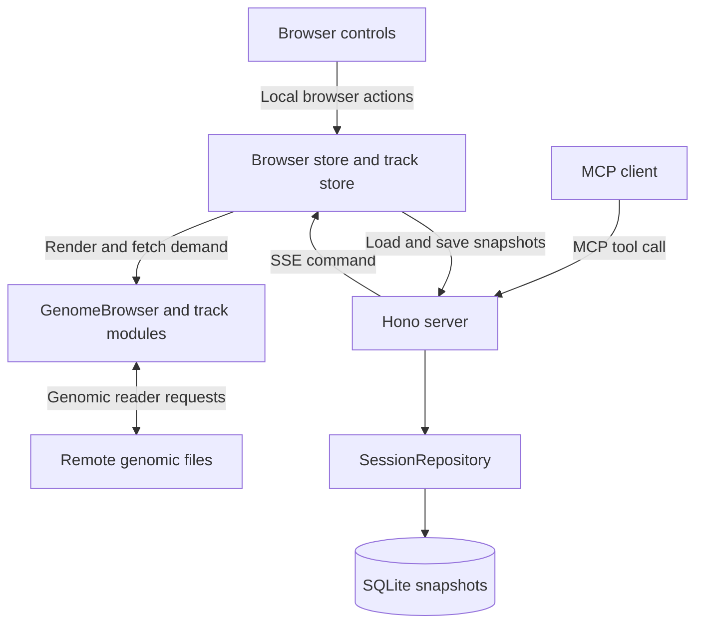
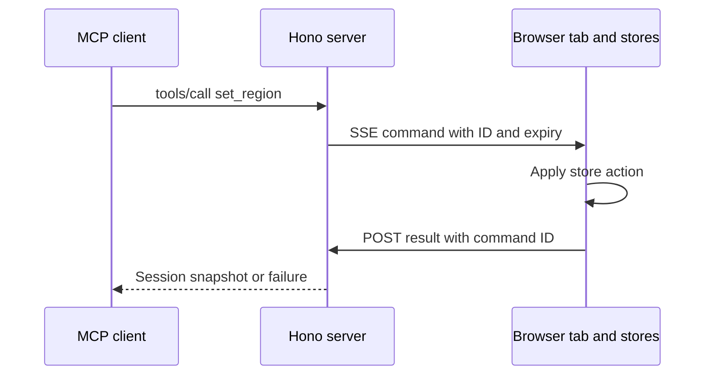
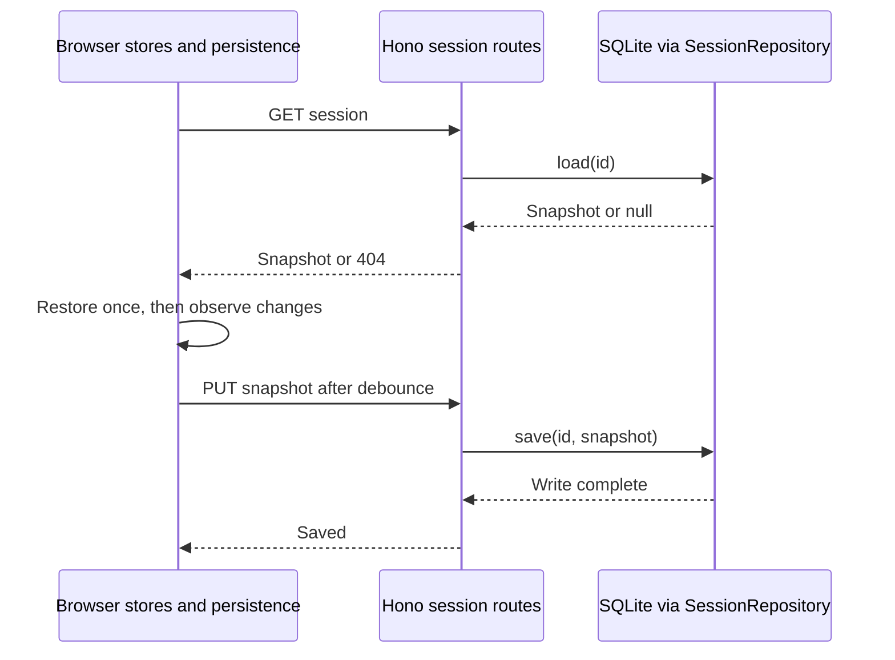

# Architecture and data flow

The browser tab owns live browser state. Next.js serves the website and rewrites `/api/*` and `/mcp` to a separate Hono server. The server saves sessions through an injected database repository and delivers agent commands to the tab that has the session open.

## Ownership

| Owner                                    | Responsibility                                                      | Lifetime                                           |
| ---------------------------------------- | ------------------------------------------------------------------- | -------------------------------------------------- |
| `AppProviders`                           | Creates the browser session and `BrowserServer` above routes        | Shared layout mount                                |
| `browser/BrowserSession.tsx`             | Browser store and track store                                       | Survive route changes; restored after refresh      |
| `browser/persistence.ts`                 | Load once, then autosave                                            | Shared layout mount                                |
| `browser/remoteControl.ts`, `execute.ts` | Command stream, store actions, and replies                          | While remote control is on                         |
| `components/workspace/`                  | Navigation, theme, panel widths and collapsed state                 | Panel state survives navigation, resets on refresh |
| `next.config.ts` rewrites                | Forward `/api/*` and `/mcp` to the server                           | Each HTTP request                                  |
| Server `http/`                           | Local host/origin checks, input validation, routes                  | Each request                                       |
| Server `commands/`, `mcp.ts`             | Command definitions, and one MCP tool per registered command        | Each MCP request                                   |
| Server `tabs.ts`, `pendingCommands.ts`   | Open tabs by session ID, pending replies, timeouts and cancellation | Each tab connection, in memory                     |
| Server `storage/`                        | Async session repository and SQLite adapter                         | Durable snapshots by session ID                    |

The browser uses `@weng-lab/genomebrowser` for stores and rendering, `@weng-lab/genomebrowser-ui` for browser controls, and `@weng-lab/genomebrowser-tracks` for track implementations. Track fetchers use `@weng-lab/genomic-reader` to read remote genomic files. MUI supplies application controls. The browser and server share the session snapshot schema through `@weng-lab/session-snapshot` and tab message schemas through `@weng-lab/browser-server/protocol`. Browser code never imports the Node.js server implementation.

The tab looks up each command in the shared registry, validates its parameters, and runs its `run` function through `browser/execute.ts`. The server never mutates the stores directly.

## Apply a command

1. An agent calls an MCP tool, such as `set_region`, with a `sessionId` and the command's parameters. The SDK validates them against the command's `params` schema.
2. The server finds the tab connected for that session. Without one, the tool fails with `NOT_CONNECTED`.
3. The tab's pending-command tracker registers a reply, assigns `commandId` and `expiresAt`, and sends an SSE `command` event.
4. The tab ignores expired commands, runs the command's `run` function, and posts its reply to `/api/sessions/:id/rpc`: the whole snapshot on success, or the store's failure.
5. The tracker clears its timer and returns the reply to the agent.

The reply means the store accepted the command. It does not mean track data has loaded or the session has been saved; the tab's autosave stores the change separately. Commands expire after five seconds by default and are not replayed on reconnect. Timeout, cancellation, disconnect, and failed stream writes clear pending commands.

Only the first tab to open a session's stream receives its commands. The server answers later tabs with 409, and they retry every second until the first tab disconnects. Turning off remote control in Settings closes the stream.

## Save and restore

On mount, the tab loads `GET /api/sessions/:id`. It validates and restores the snapshot before showing the browser view. With no saved snapshot, it uses hg38 defaults: the coordinate ruler, GENCODE 50 basic genes in merged display, and human cCREs. A saved track list replaces these defaults.

After loading, store changes produce a serializable snapshot. The tab debounces writes for 200 ms and sends one `PUT` at a time. The server validates it, calls `SessionRepository.save`, and responds after the write completes. `SaveStatus` at the top left of the center panel shows saving, saved, or retry status. Failed loads and writes retry after two seconds. Saving does not depend on remote control.

A refresh creates new stores and restores the last successful save. Every tab with the session open saves to it; the last save wins, and live edits are not broadcast between tabs. See [Shared session](../../README.md#shared-session) for snapshot contents and retries.

SQLite is supplied in the server entry point through `SessionRepository`. Another database can replace it without changing routes.

## Load track data

A local browser action or remote command changes the same stores. Core determines which tracks need data; their fetchers use genomic readers to request remote files directly from the browser. The Hono server and SQLite database are not on this data path. Fetched records, loading state, and runtime resources are not saved in the session snapshot. Source URLs and track configuration are saved.

For extension points, see [Add a command](../../../server/README.md#add-a-command). Definitions live in the [app glossary](../../glossary.md#commands-and-persistence).

[Back to the docs home](../README.md)
