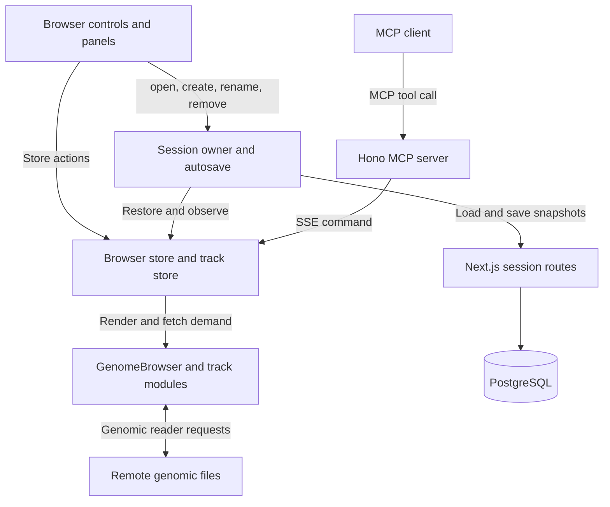
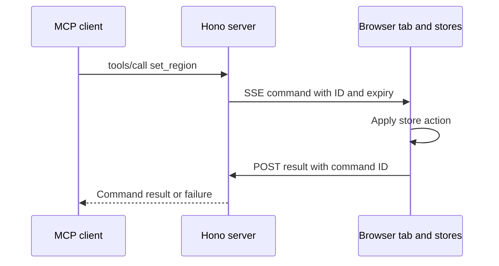
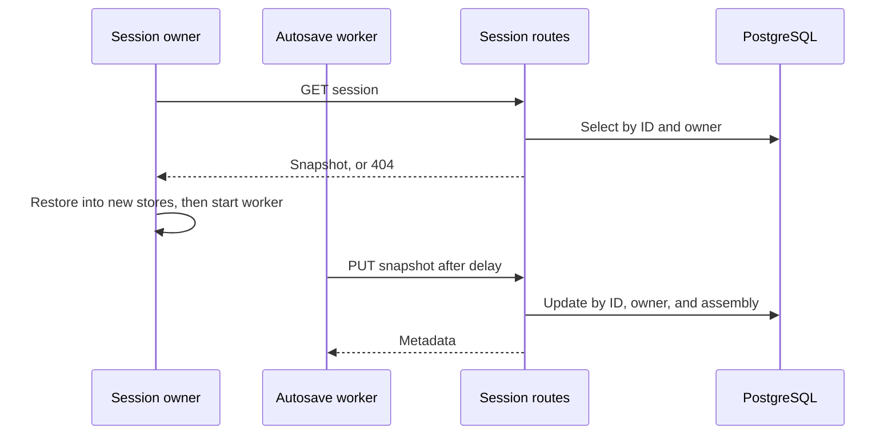

# Architecture and data flow

The browser tab owns live browser state. Next.js serves the website and the saved-session routes, which store each user's sessions in PostgreSQL. It rewrites `/mcp` and tab command streams to the optional Hono MCP server, which delivers agent commands to the tab that has the session open.

## Ownership

| Owner                                                           | Responsibility                                                    | Lifetime                                              |
| --------------------------------------------------------------- | ----------------------------------------------------------------- | ----------------------------------------------------- |
| `app/(workspace)/layout.tsx`, `AppProviders`                    | Resolve the account; mount session and remote-control providers   | Shared layout mount, per account                      |
| `sessions/session.ts`                                           | Session list, open session and its stores, and session operations | Shared layout mount, per account                      |
| `sessions/autosave.ts`                                          | Effect worker that saves the open session                         | From restoration until replaced or removed            |
| `sessions/transport.ts`                                         | Cancellable requests to the session routes                        | Each request                                          |
| `assemblies/assemblies.ts`                                      | Supported assemblies and their default stores                     | Module                                                |
| `app/api/sessions/`, `server/sessions/`                         | Identity, validation, ownership checks, PostgreSQL                | Each request                                          |
| `commands/RemoteControl.tsx`, `remoteControl.ts`, `commands.ts` | Command stream, command handlers, and replies                     | While remote control is on and the open session saves |
| `components/workspace/`                                         | Navigation, theme, panel widths and collapsed state               | Panel state survives navigation                       |
| `next.config.ts` rewrites                                       | Forward `/mcp` and `/rpc/:id` to the MCP server                   | Each HTTP request                                     |
| `commands/contracts.ts`                                         | Command contracts and wire schemas                                | Module                                                |
| Server `mcp.ts`, `tabs.ts`, `pendingCommands.ts`                | MCP tools, open tabs, pending replies                             | MCP server process, in memory                         |

The browser uses `@weng-lab/genomebrowser` for stores and rendering, `@weng-lab/genomebrowser-ui` for browser controls, and `@weng-lab/genomebrowser-tracks` for track implementations. Track fetchers use `@weng-lab/genomic-reader` to read remote genomic files. MUI supplies application controls. The session snapshot schema comes from `sessions/snapshot.ts`, and command contracts and tab message schemas from `commands/contracts.ts`. The MCP server imports only these pure contract modules from the web app, with no Next.js or browser-runtime dependencies.

The tab looks up each command's contract, validates its parameters, and runs its handler in `commands/commands.ts`. The server never mutates the stores directly.

## Apply a command

1. An agent calls an MCP tool, such as `set_region`, with a `sessionId` and the command's parameters. The SDK validates them against the contract's `params` schema.
2. The server finds the tab connected for that session. Without one, the tool fails with `NOT_CONNECTED`.
3. The tab's pending-command tracker registers a reply, assigns `commandId` and `expiresAt`, and sends an SSE `command` event.
4. The tab ignores expired commands and rejects commands for a session that is no longer open and saving with `SESSION_CLOSED`. It runs the command's handler and posts its reply to `/rpc/:id`: the command's result on success, or the store's failure.
5. The tracker clears its timer. The server checks the result against the contract's `result` schema and returns it to the agent.

The reply means the store accepted the command. It does not mean track data has loaded or the session has been saved; the tab's autosave stores the change separately. Commands expire after five seconds by default and are not replayed on reconnect. Timeout, cancellation, disconnect, and failed stream writes clear pending commands.

Only the first tab to open a session's stream receives its commands. The server answers later tabs with 409, and they retry every second until the first tab disconnects. Turning off remote control in Settings closes the stream. So does the session's `signal` from `sessions/session.ts`, which aborts when the session is replaced or closed, or can no longer save edits.

## Save and restore

Opening a session loads `GET /api/sessions/:id`, creates stores for its assembly, and restores the snapshot. Only then does autosave subscribe to the stores. A failed or missing load never writes.

Each edit to the stores or the name produces a snapshot. About 200 ms later, the worker sends `PUT /api/sessions/:id` with the whole snapshot and name. It sends one write at a time and keeps the newest edits for the next one. A write acknowledges only the snapshot it sent. Transient failures retry with backoff. Refused input is not sent again until a further edit. `NOT_FOUND` ends saving rather than recreating the session; its edits stay unsaved and keep the tab from opening another session until they are discarded.

Opening another session saves the open one first and replaces the stores only once nothing is unsaved. Deleting the open session holds writes, waits for one in progress, then deletes. See [Sessions](../../README.md#sessions) for failure behavior and multi-tab limits.

## Load track data

A local browser action or remote command changes the same stores. Core determines which tracks need data; their fetchers use genomic readers to request remote files directly from the browser. Neither server is on this data path. Fetched records, loading state, and runtime resources are not saved in the session snapshot. Source URLs and track configuration are saved.

For extension points, see [Add a command](../../commands/README.md#add-a-command). Definitions live in the [app glossary](../../glossary.md#commands-and-persistence).

[Back to the docs home](../README.md)
